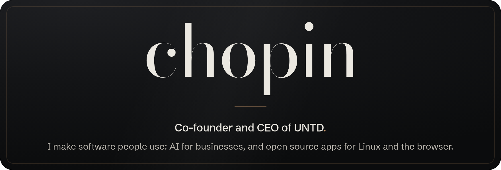
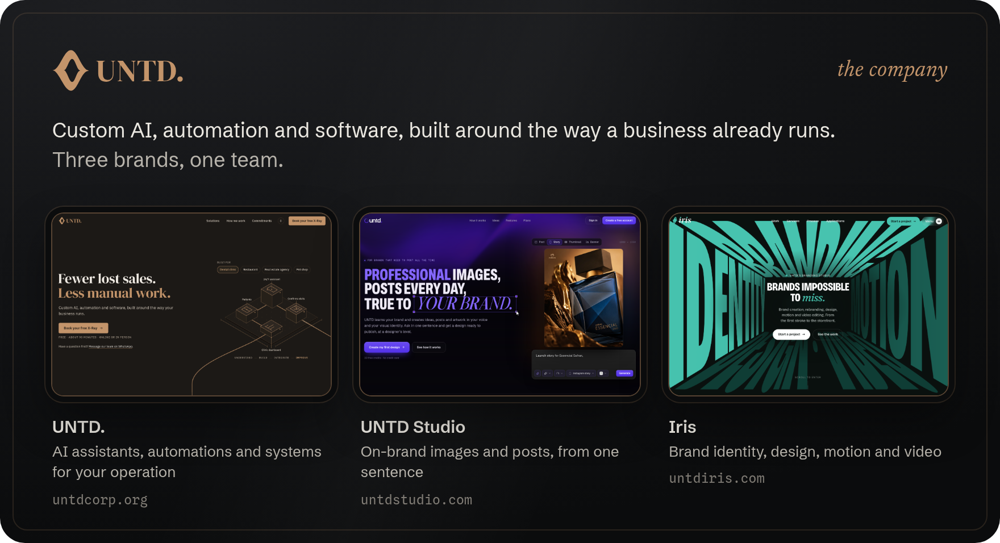
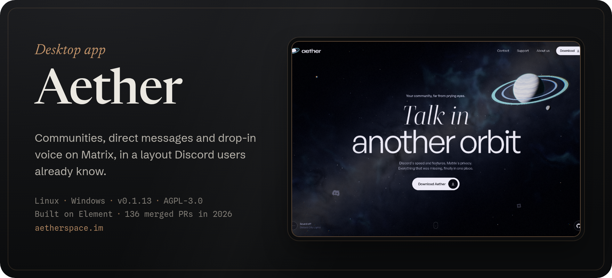
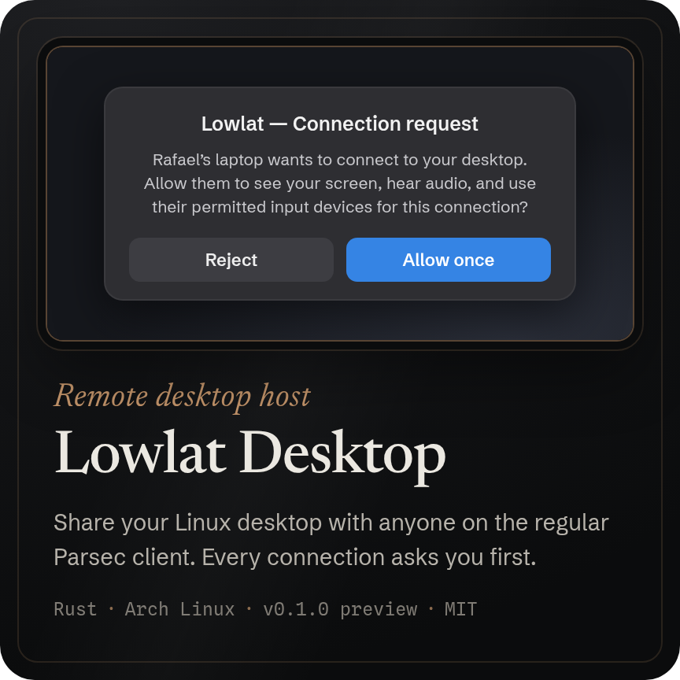
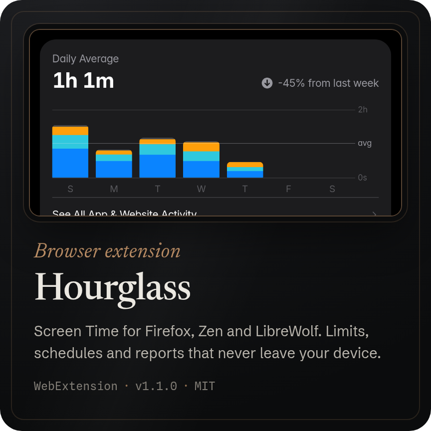
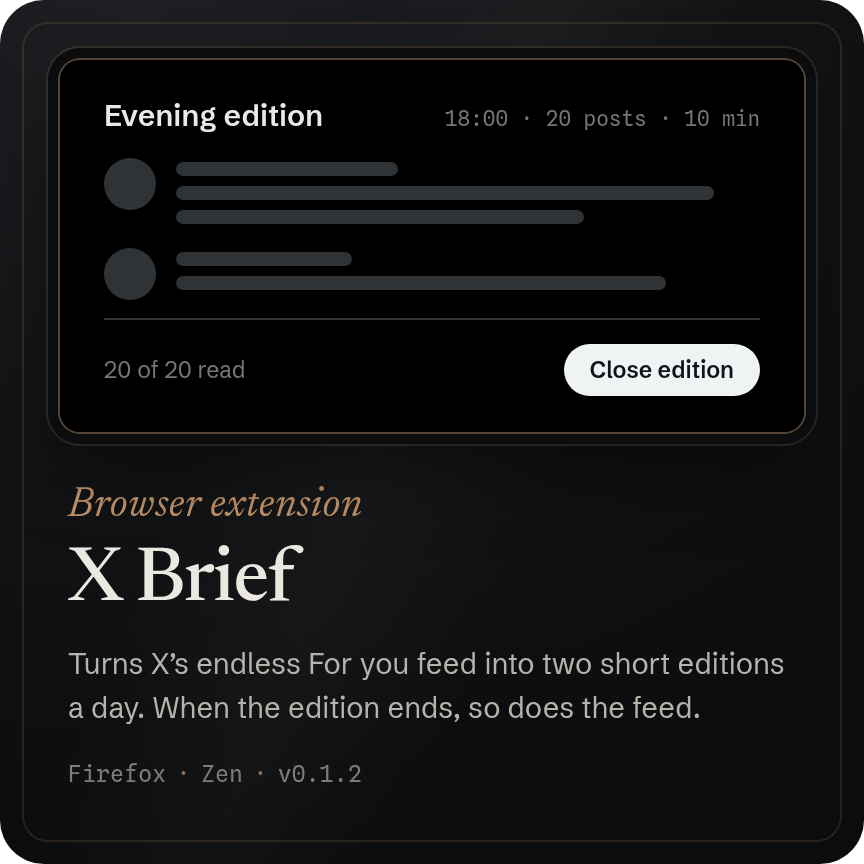
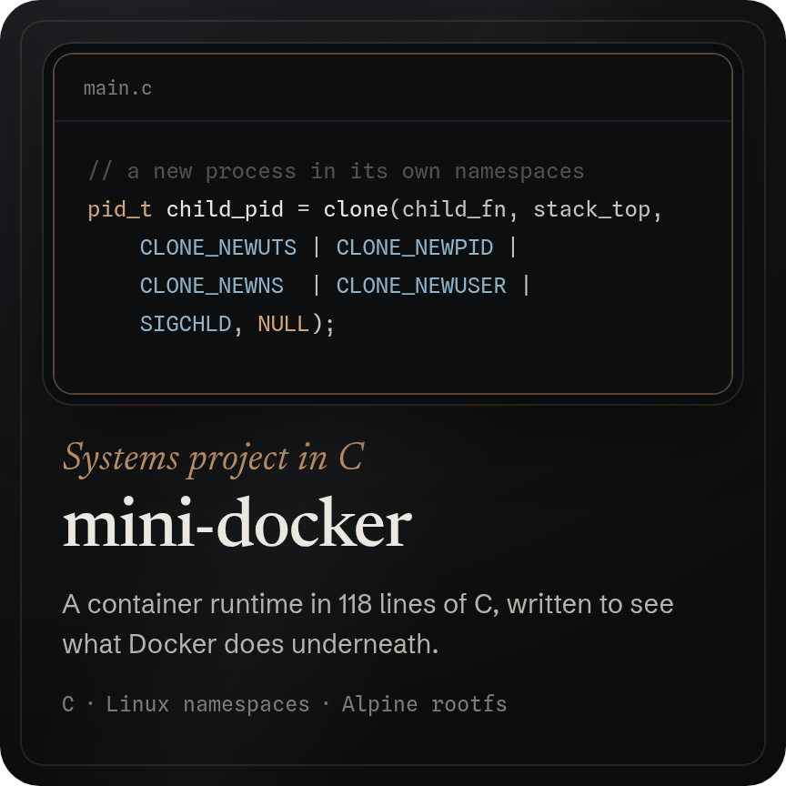

  <a href="#work-with-untd"><b>Work with UNTD</b></a> &nbsp;·&nbsp;
  <a href="#apps-you-can-use-today"><b>Apps you can use today</b></a> &nbsp;·&nbsp;
  <a href="#build-with-me"><b>Build with me</b></a>

 

## Work with UNTD

We build the AI assistant, the automation or the internal system your business is missing, shaped around how it already works. Every project starts with a free **Operations X-Ray**: about 90 minutes, online or in person, and you leave knowing where your operation loses time and sales.

**[Book your free X-Ray](https://untdcorp.org/en/)** &nbsp;·&nbsp; [Create on-brand images with UNTD Studio](https://untdstudio.com) &nbsp;·&nbsp; [Start a brand with Iris](https://untdiris.com)

 

## Apps you can use today

**Download:** [Aether for Linux and Windows](https://aetherspace.im) ([source](https://github.com/chopin014/Aether)) &nbsp;·&nbsp; [Lowlat Desktop for Arch](https://github.com/chopin014/lowlat-desktop/releases/latest) &nbsp;·&nbsp; [Hourglass](https://github.com/chopin014/hourglass-screen-time/releases/latest) &nbsp;·&nbsp; [X Brief](https://github.com/chopin014/x-brief/releases/latest)

 

## Build with me

I like small, measured changes that a reviewer can hold in their head. This year most of mine went into Aether's new message timeline. A few of them:

- [Measure room switches with enough samples, their long tasks, and encrypted rooms](https://github.com/chopin014/Aether/pull/166)
- [Read the layout less while a room opens](https://github.com/chopin014/Aether/pull/168)
- [Keep the timeline at its newest message while the rows above it change](https://github.com/chopin014/Aether/pull/164)

If you want to build on any of these, open an issue or a pull request. For anything else, reach me through [untdcorp.org](https://untdcorp.org/en/).
